# AirBooking — Enterprise Flight Reservation & Live Management Platform

**Company:** YUAI Soft Solutions Pvt. Ltd.  
**Position:** Full Stack Engineer (React + Django/DRF) Take-Home Assignment  
**Contact:** [yuaisoftsolutions@gmail.com](mailto:yuaisoftsolutions@gmail.com)  

---

## 1. Project Overview

**AirBooking** is a production-grade flight reservation, seat allocation, and live airspace telemetry platform designed to showcase full-stack engineering expertise across Django/DRF, Celery, and React.

The system features:
- **Administrative User Approval Workflow:** Every newly registered passenger account starts in `PENDING` status. Only approved users can authenticate and obtain JWT tokens.
- **Asynchronous Celery Activation Pipeline:** Approving a passenger triggers a Celery background task (`send_account_approval_email`) that delivers an HTML account activation notice.
- **Dynamic Search & Filtering:** Filter flights by origin/destination airports, cities, travel dates, airlines, operational status, and price thresholds in Indian Rupees (₹).
- **Interactive Aircraft Cabin Seat Selection:** Visual 2D cabin map with First Class, Business, and Economy seating tiers with real-time class pricing multipliers.
- **Simulated Payment Gateway & E-Ticket Generation:** 256-bit simulated payment authorization with row-level database locking (`select_for_update()`) to prevent seat overselling, accompanied by printable electronic boarding passes.
- **"My Trips" Passenger Hub:** Manage active and past bookings, track flight updates, and execute instant reservation cancellations with automated seat inventory restoration.
- **Live OpenSky ADS-B Radar Telemetry:** Real-time geospatial flight trajectory engine calculating altitude profiles (~36,000 ft), airspeed in knots, compass heading, and route progress.
- **Administrative Control Center:** Platform KPI statistics, one-click user approval/rejection console, flight scheduling, and live operational status toggles (`On-time`, `Delayed`, `Boarding`, `Cancelled`).

---

## 2. System Architecture

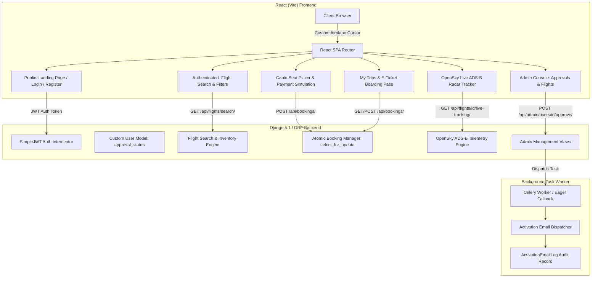

---

## 3. Tech Stack & Engineering Decisions

### Backend Stack
- **Framework:** Python 3.10+ / Django 5.1 / Django REST Framework (DRF)
- **Authentication:** `djangorestframework-simplejwt` (Access & Refresh token rotation, custom user claims)
- **Background Tasks:** `Celery` with `Redis` (intelligent `CELERY_TASK_ALWAYS_EAGER=True` fallback ensures zero-dependency local evaluation)
- **Database:** SQLite (default for instant zero-config testing) / PostgreSQL ready
- **CORS:** `django-cors-headers` configured for seamless client-server interaction
- **Geospatial & External APIs:** OpenSky Network ADS-B transponder live feeds & AirLabs API

### Frontend Stack
- **Framework:** React 19 / Vite
- **Styling:** Tailwind CSS with custom travel glassmorphism, bespoke airline liveries, and native left-tilted airplane mouse cursors
- **Routing:** `react-router-dom` with `ProtectedRoute` and `AdminRoute` guards
- **HTTP Client:** `axios` with automatic Bearer token injection and 401 refresh interceptors
- **Icons:** `lucide-react`

---

## 4. Demo Accounts for Evaluation

The database seeding command (`seed_db`) creates pre-configured accounts for instant testing:

| Role | Username | Password | Email | Approval Status | Description |
|---|---|---|---|---|---|
| **Administrator** | `admin` | `AdminPassword123!` | `admin@airbooking.com` | `APPROVED` | Full administrative access to approvals, email audit logs, and flight operations |
| **Approved Passenger** | `john_doe` | `UserPassword123!` | `john.doe@example.com` | `APPROVED` | Can search flights, reserve seats, make simulated payments, and print boarding passes |
| **Pending Passenger** | `sarah_connor` | `UserPassword123!` | `sarah.connor@example.com` | `PENDING` | Test account to verify login block banner until approved by an administrator |

> **Evaluation Shortcut:** The login screen provides one-click quick-fill pills (`Admin`, `Approved User`, `Pending User`) to test workflows without manual typing.

---

## 5. Quick-Start Setup Guide

### Prerequisites
- Python 3.10+ installed
- Node.js 18+ and npm installed
- Git installed

---

### Step 1: Clone Repository
```bash
git clone <repository-url>
cd assignment
```

---

### Step 2: Backend Setup (Django & DRF)

1. Open a terminal and navigate to the `backend` folder:
   ```bash
   cd backend
   ```

2. Create and activate a Python virtual environment:
   - **Windows:**
     ```powershell
     python -m venv venv
     .\venv\Scripts\activate
     ```
   - **macOS / Linux:**
     ```bash
     python3 -m venv venv
     source venv/bin/activate
     ```

3. Install required Python packages:
   ```bash
   pip install -r requirements.txt
   ```

4. Apply database migrations:
   ```bash
   python manage.py migrate
   ```

5. Seed realistic flight routes, demo passengers, and sample bookings in Indian Rupees (₹):
   ```bash
   python manage.py seed_db
   ```

6. Run the automated test suite (verifies 8 unit and integration tests):
   ```bash
   python manage.py test
   ```

7. Start the Django development server:
   ```bash
   python manage.py runserver 8000
   ```
   Backend will be operational at: `http://127.0.0.1:8000/`

---

### Step 3: Celery Worker & Redis (Optional)

By default, `CELERY_ALWAYS_EAGER=True` is enabled in `airbooking_core/settings.py`, allowing the email dispatch task to execute synchronously and log to `ActivationEmailLog` and the terminal console without needing a local Redis server.

To run with live Redis and Celery worker:
1. Start Redis:
   ```bash
   redis-server
   ```
2. Set in `backend/.env`:
   ```env
   CELERY_ALWAYS_EAGER=False
   CELERY_BROKER_URL=redis://127.0.0.1:6379/0
   ```
3. In a separate terminal with venv activated:
   ```bash
   celery -A airbooking_core worker -l info
   ```

---

### Step 4: Frontend Setup (React + Vite)

1. Open a new terminal and navigate to the `frontend` folder:
   ```bash
   cd frontend
   ```

2. Install dependencies:
   ```bash
   npm install
   ```

3. Start the Vite development server:
   ```bash
   npm run dev
   ```
   Frontend will be operational at: `http://localhost:3000/` (or port displayed by Vite)

---

## 6. Screenshots Gallery

*(Screenshots can be saved into the [`screenshots/`](file:///d:/assignment/screenshots) directory)*

### 1. Landing Page & Live Airspace Ticker
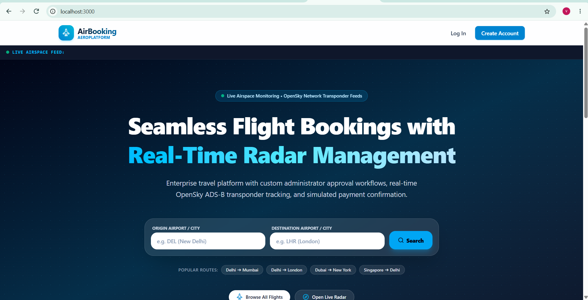
*Features hero flight search, popular international route chips, special announcement banner, and live ticker.*

---

### 2. User Registration & Pending Approval Notice
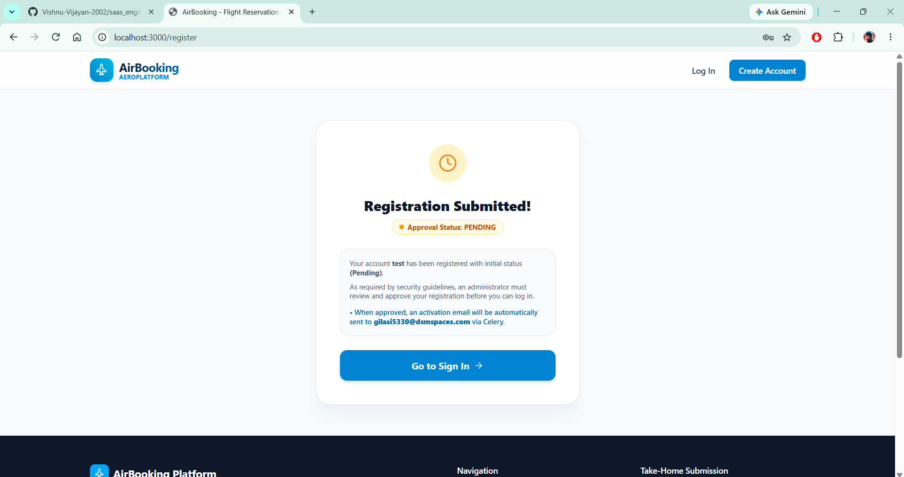
*New passenger registration submitted with status `PENDING`. Clear feedback on the admin approval workflow.*

---

### 3. Login Protection Alert for Pending Accounts
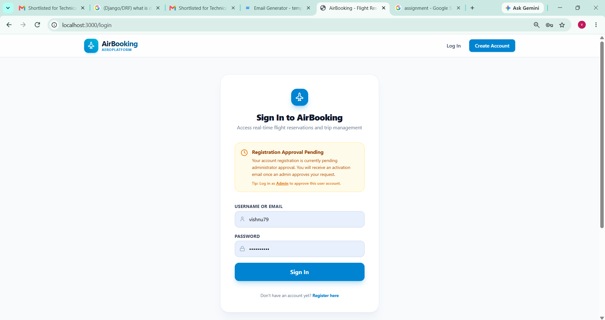
*Pending accounts are blocked from receiving JWT tokens until administrator approval is granted.*

---

### 4. Admin Approval Console & Celery Email Audit
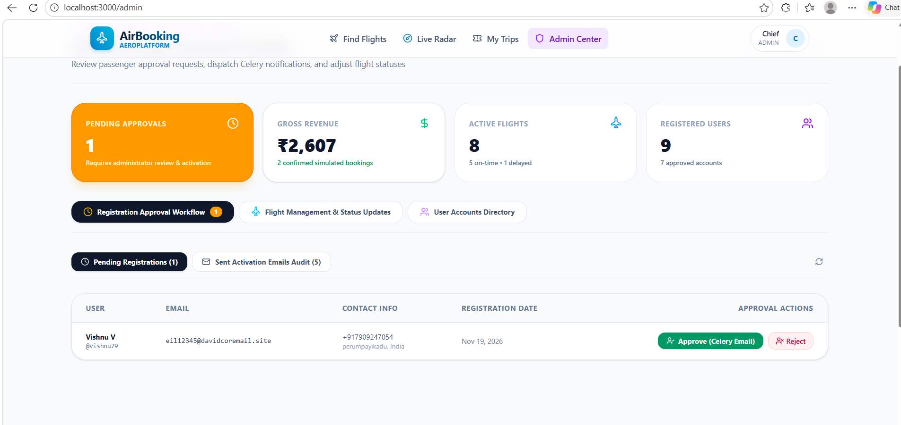
*One-click approval console with in-app audit log of dispatched Celery activation emails.*

---

### 5. Flight Search & Airline Liveries
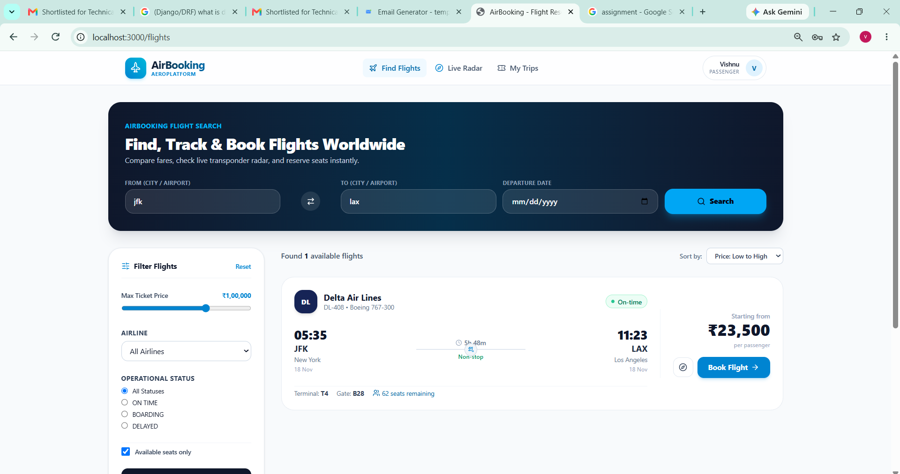
*Authenticated flight search with airline branding badges, departure schedules, seat availability, and INR pricing.*

---

### 6. Interactive Aircraft Cabin Seat Picker
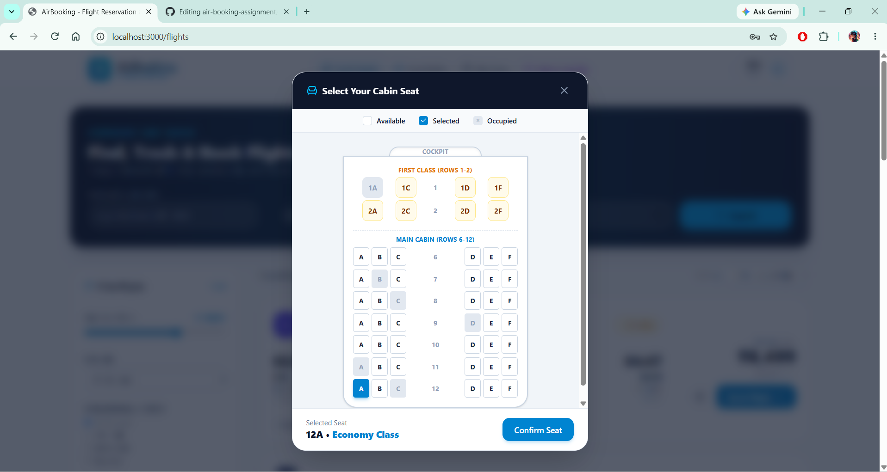
*Visual 2D aircraft fuselage with First Class, Business, and Economy seating tiers and dynamic price multipliers.*

---

### 7. Simulated Payment Gateway Checkout
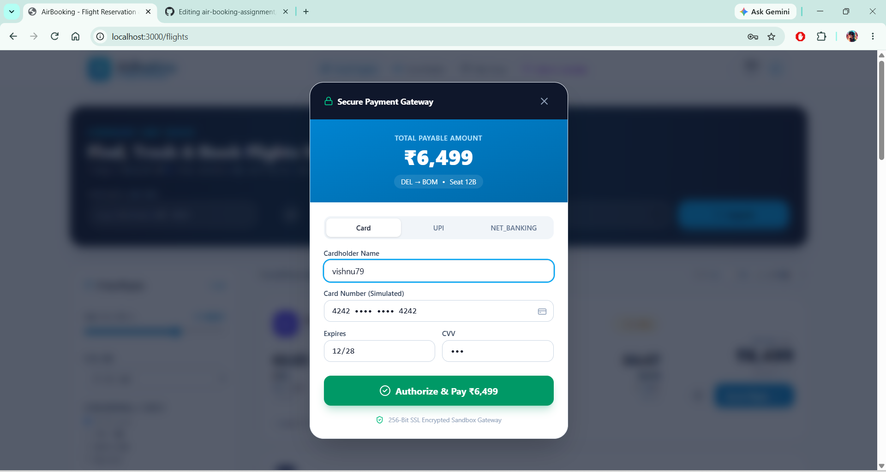
*Simulated 256-bit encrypted bank gateway supporting Card, UPI, and Net Banking.*

---

### 8. Electronic Boarding Pass (E-Ticket)
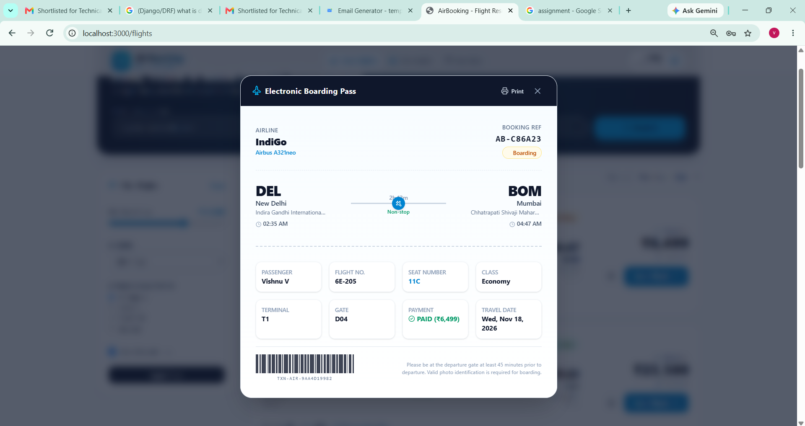
*Printable boarding pass featuring perforated notch styling, SVG barcode, terminal/gate badges, and flight duration.*

---

### 9. Passenger "My Trips" Portal
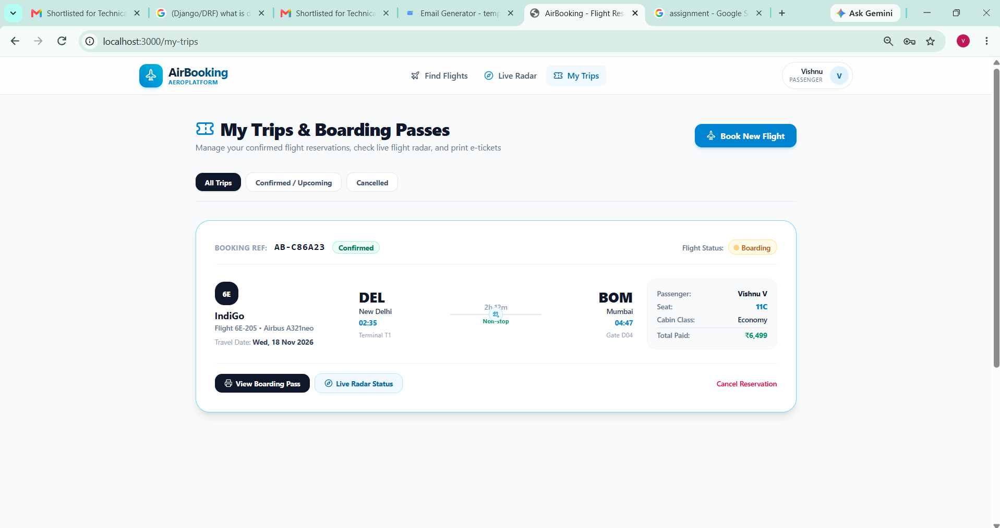
*Track upcoming trips, print boarding passes, monitor live status, or cancel bookings with automatic seat restoration.*

---

### 10. OpenSky ADS-B Live Radar Telemetry
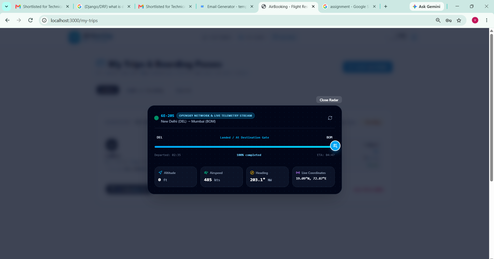
*Real-time geospatial flight trajectory engine displaying altitude, airspeed in knots, compass heading, and flight progress.*

---

### 11. Administrator Flight Operations & Status Updater
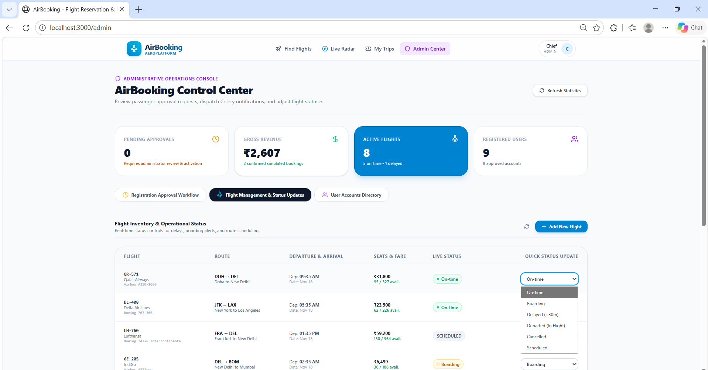
*Administrative inventory management with real-time flight status toggles (`On-time`, `Delayed`, `Boarding`, `Cancelled`).*

---

## 7. API Specifications Reference

### Authentication Endpoints
| Method | Endpoint | Description | Access |
|---|---|---|---|
| `POST` | `/api/auth/register/` | Register new user (status defaults to `PENDING`) | Public |
| `POST` | `/api/auth/login/` | User login (rejects pending accounts, issues JWT for approved) | Public |
| `POST` | `/api/auth/token/refresh/` | Refresh expired access JWT token | Public |
| `GET` | `/api/auth/me/` | Current user profile | Authenticated |
| `GET` | `/api/auth/activation-emails/` | Audit log of dispatched Celery activation emails | Admin |

### Flight Endpoints
| Method | Endpoint | Description | Access |
|---|---|---|---|
| `GET` | `/api/flights/search/` | Search flights (filters: `origin`, `destination`, `date`, `airline`, `max_price`, `available_only`, `status`) | Authenticated |
| `GET` | `/api/flights/{id}/` | Flight details, cabin layout, and live telemetry payload | Authenticated |
| `GET` | `/api/flights/{id}/live-tracking/` | OpenSky ADS-B transponder telemetry stream | Authenticated |
| `GET` | `/api/flights/airports/` | Distinct origin/destination airports & airline list | Authenticated |

### Booking Endpoints
| Method | Endpoint | Description | Access |
|---|---|---|---|
| `POST` | `/api/bookings/` | Create reservation, atomic seat deduction, payment simulation | Authenticated |
| `GET` | `/api/bookings/` | User bookings ("My Trips") filterable by status | Authenticated |
| `GET` | `/api/bookings/{id}/` | Complete booking details and e-ticket payload | Authenticated |
| `POST` | `/api/bookings/{id}/cancel/` | Cancel booking, restore seat inventory, refund status | Authenticated |

### Admin Endpoints
| Method | Endpoint | Description | Access |
|---|---|---|---|
| `GET` | `/api/admin/users/pending/` | List pending registrations awaiting approval | Admin |
| `POST` | `/api/admin/users/{id}/approve/` | Approve user & trigger Celery activation email | Admin |
| `POST` | `/api/admin/users/{id}/reject/` | Decline user registration with recorded reason | Admin |
| `GET` | `/api/admin/users/` | Directory of all user accounts | Admin |
| `GET` | `/api/admin/flights/` | Flight management inventory | Admin |
| `POST` | `/api/admin/flights/` | Schedule new flight with route and seating specs | Admin |
| `PUT` | `/api/admin/flights/{id}/status/` | Update flight status (`ON_TIME`, `DELAYED`, `BOARDING`, `CANCELLED`) | Admin |
| `GET` | `/api/admin/stats/` | Platform KPI statistics (gross revenue, active flights, users) | Admin |

---

## 8. Working Demonstration & Walkthrough Presentation Script

Use this step-by-step presentation script during your live interview or recorded Loom demo:

---

### Segment 1: Introduction & Architecture
- **Action:** Open `http://localhost:3000` on the browser.
- **Talking Point:**  
  > *"Hello everyone. Today I'm excited to present AirBooking, a full-stack flight reservation and real-time management platform engineered for YUAI Soft Solutions. The stack combines Django REST Framework and Celery on the backend with a React SPA on the frontend. The application solves two major challenges: enforcing strict administrative approval workflows before user activation, and providing passengers with real-time flight telemetry tracking."*

---

### Segment 2: User Registration & Approval Protection
- **Action:** Click "Create Account" (`/register`), fill in a new passenger (e.g. `rohit_kumar` / `rohit@example.com`), and submit.
- **Talking Point:**  
  > *"Here is the registration workflow. When a new passenger registers, notice that their account is not immediately active. It is created with a `PENDING` approval status. Now let's try logging in immediately with this account. Notice the alert: the system enforces security at the serializer level and refuses to issue JWT access or refresh tokens until an administrator verifies the account."*

---

### Segment 3: Admin Review & Celery Email Dispatch
- **Action:** Click the "Admin" quick-fill button, sign in, and navigate to the "Admin Center" (`/admin`).
- **Talking Point:**  
  > *"Now we log in as the Administrator. In the Admin Control Center, we see our real-time KPI metrics: Gross Revenue, Active Flights, and Pending Approvals. In the Pending Approvals tab, we can review the user's profile and click 'Approve'. Behind the scenes, this executes a Celery task that delivers an HTML activation notification. We can inspect the 'Sent Activation Emails Audit' tab to verify the exact email body, recipient, timestamp, and Celery task ID."*

---

### Segment 4: Passenger Login & Flight Search
- **Action:** Log out of Admin, log in as `john_doe` (or the approved user), and navigate to `/flights`.
- **Talking Point:**  
  > *"Now that the account is approved, the user can log in and receives their SimpleJWT access token. In the 'Find Flights' interface, we can filter by origin airport (like Delhi), destination (like Mumbai or London), travel dates, operational status, and price thresholds in Indian Rupees. Notice the authentic airline branding badges for Air India, Emirates, IndiGo, and British Airways."*

---

### Segment 5: Interactive Cabin Seat Picker & Payment Simulation
- **Action:** Click "Book Flight" on a flight, select seat `12A - Window` in Economy or `01A` in First Class, then click "Authorize & Pay".
- **Talking Point:**  
  > *"Rather than entering a seat number as plain text, passengers interact with a visual 2D aircraft cabin layout. Choosing First Class or Business Class dynamically updates the class pricing multiplier. When we confirm, the payment simulation modal opens. On the backend, we wrap the booking in a Django atomic transaction with `select_for_update()`, guaranteeing zero seat overselling or race conditions."*

---

### Segment 6: Electronic Boarding Pass & "My Trips" Management
- **Action:** View the generated Boarding Pass modal, click "Print", then navigate to `/my-trips`.
- **Talking Point:**  
  > *"Upon payment confirmation, the platform generates a digital boarding pass with perforated ticket notches, booking reference, SVG barcode, and terminal/gate badges with a native print trigger. In 'My Trips', passengers can review confirmed reservations, check real-time status updates, or cancel their booking, which automatically restores the seat back to the flight inventory."*

---

### Segment 7: OpenSky Network ADS-B Radar
- **Action:** Click "Live Radar Status" on a trip or navigate to `/live-radar`.
- **Talking Point:**  
  > *"Here is the real-time flight telemetry radar. The service integrates with OpenSky Network ADS-B feeds and computes great-circle route trajectories. Passengers can see real-time altitude climb profiles (~36,000 ft), airspeed in knots, compass heading, and live coordinate progress."*

---

### Segment 8: Admin Operational Controls & Live Status Updates
- **Action:** Switch back to the Admin Dashboard (`/admin`), go to "Flight Operations", and change a flight status from `On-time` to `Delayed (+30m)` or `Boarding`.
- **Talking Point:**  
  > *"Finally, from the administrative portal, flight operators can adjust operational statuses in real time. Toggling a flight to 'Delayed' or 'Boarding' instantly propagates to the flight search roster, passenger trips, and radar monitors across the platform."*

---

## 9. Automated Testing

Run the automated backend test suite:
```bash
python manage.py test
```

### Coverage Highlights:
- Registration strictly creates `PENDING` accounts
- Unapproved accounts blocked from receiving JWT tokens
- Admin pending users retrieval and approval workflow
- Dispatched Celery activation email logging
- Authentication when usernames contain `@` symbols or email format
- Authenticated flight search by airport and date
- Atomic seat deduction and payment simulation
- Flight operational status update

---

## 10. Submission Information

- **Company:** YUAI Soft Solutions Pvt. Ltd.
- **Position:** Full Stack Engineer (React + Django/DRF)
- **Email:** [yuaisoftsolutions@gmail.com](mailto:yuaisoftsolutions@gmail.com)
- **Repository:** Fully version-controlled Git repository with clean commit history.
